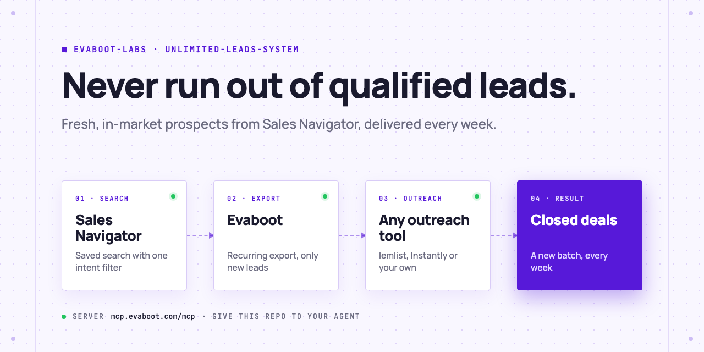
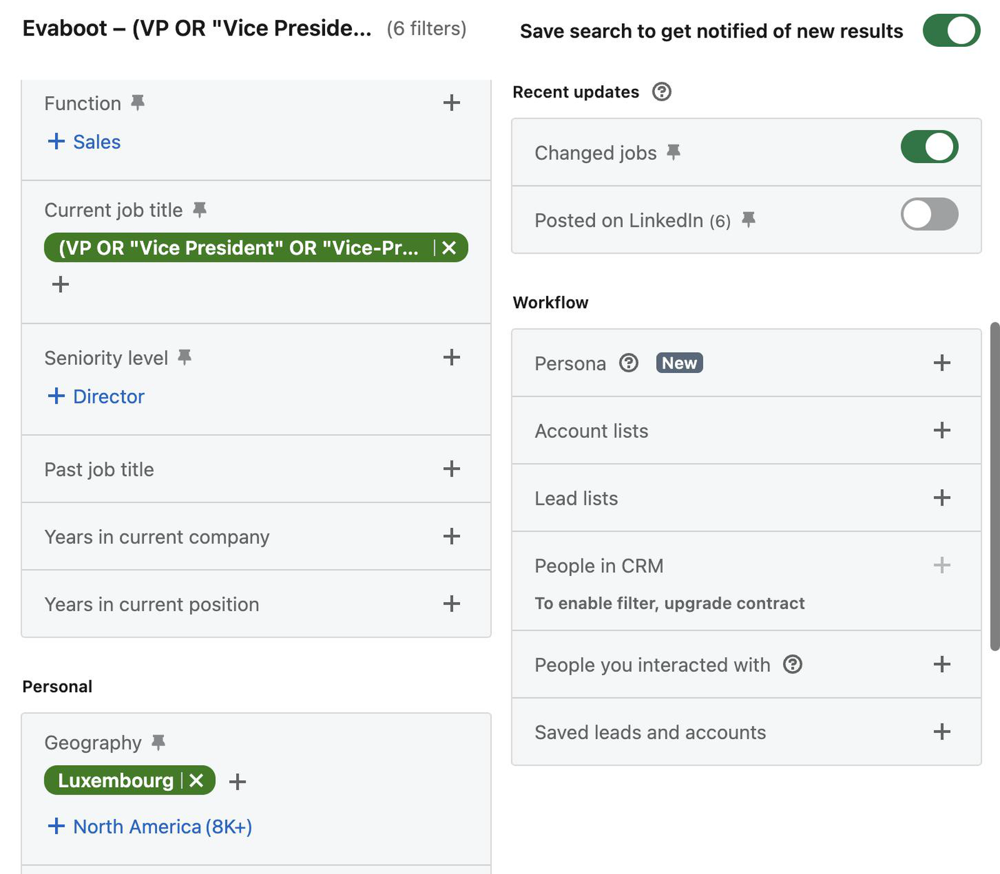
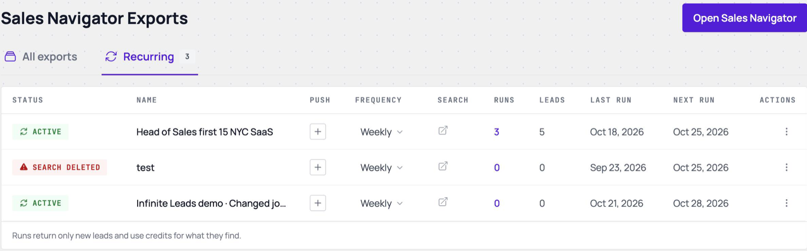
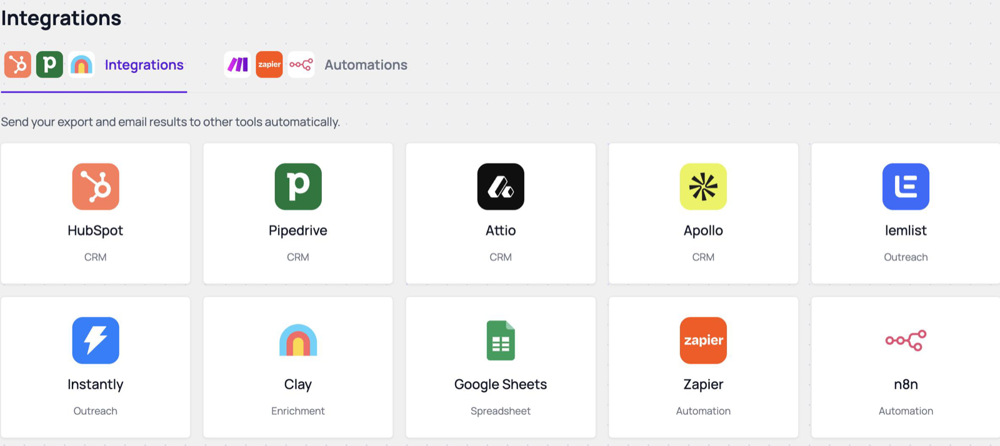
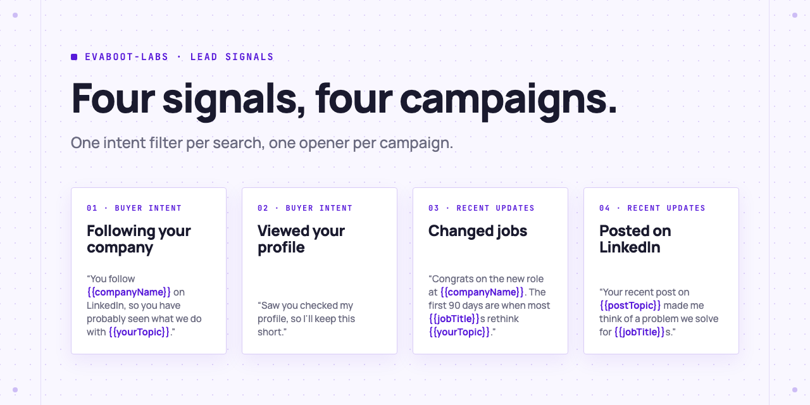

<picture>
  <source media="(prefers-color-scheme: dark)" srcset=".github/assets/banner-dark.png">
  
</picture>

# The Unlimited Leads System

Never run out of qualified leads. Sales Navigator finds them, Evaboot exports only the new ones every week, and your outreach tool contacts them.

[](AGENTS.md)
[](https://evaboot.com/mcp)
[](LICENSE)
[](https://github.com/evaboot-labs/unlimited-leads-system/generate)

[](.github/assets/demo.mp4)

<sub>The full run, at real speed: [demo.mp4](.github/assets/demo.mp4)</sub>

## Set it up in one prompt

Paste this into Claude Code, Codex or Cursor:

```text
Set up the Evaboot Unlimited Leads System for me.
Clone https://github.com/evaboot-labs/unlimited-leads-system, read AGENTS.md and follow the
evaboot-unlimited-leads-system skill. Use the Evaboot MCP server at https://mcp.evaboot.com/mcp.
If I have no Evaboot account yet, walk me through creating one first. Ask me about my ideal
customer and my outreach tool, and confirm with me before you save any search, list or
recurring export.
```

<details>
<summary>Or install the skill</summary>

Claude Code:

```text
/plugin marketplace add evaboot-labs/unlimited-leads-system
/plugin install unlimited-leads-system@evaboot-labs-unlimited-leads-system
```

Codex, Cursor and other agents:

```bash
npx skills add evaboot-labs/unlimited-leads-system
```

</details>

## How it works

**1. Save a search.** One intent filter keeps it tracking new people.



**2. Export it weekly.** Each run returns only the leads added since the last one.



**3. Send it to a campaign.** Every batch lands in your outreach tool, one campaign per signal.



## Four signals, four campaigns

<picture>
  <source media="(prefers-color-scheme: dark)" srcset=".github/assets/signals-dark.png">
  
</picture>

Each signal gets its own saved search, recurring export and campaign, with copy written for the reason you are reaching out now: [intent-filters.md](skills/evaboot-unlimited-leads-system/references/intent-filters.md).

## What you need

- **An Evaboot account.** [Create one](https://dash.evaboot.com/accounts/signup/?last_click_origin=unlimited-leads-repo), or paste the prompt and your agent walks you through sign-up.
- **LinkedIn Sales Navigator**, connected with the [Evaboot Chrome extension](https://dash.evaboot.com/install/).
- **Any outreach tool.** lemlist and Instantly connect in Evaboot under [Integrations](https://dash.evaboot.com/dash/integrations/); any other tool works through [Make](docs/make.md) or [n8n](docs/n8n.md).
- **An AI Agent that speaks MCP:** Claude Code, Codex, Cursor, or Claude and ChatGPT with a connector.
- **Cost:** Evaboot credits for the leads each run finds. The MCP server and this repo are free.

## Go further

| Page | For |
|---|---|
| [Connect your agent by hand](docs/connect-your-agent.md) | The MCP setup for each agent, `ICP.md` and the `check` command |
| [Make scenario](docs/make.md) | Filter, enrich or route leads in Make before the campaign |
| [n8n workflow](docs/n8n.md) | The same, in n8n |
| [Company signals](docs/company-signals.md) | Hiring, funding, leadership changes and headcount growth through account lists, plus every command |
| [Do it by hand](docs/manual-setup.md) | Ten minutes in the browser, no agent |

---

Agents: start at [AGENTS.md](AGENTS.md) · Built by [Evaboot](https://evaboot.com) · More workflows at [github.com/evaboot-labs](https://github.com/evaboot-labs) · [MIT license](LICENSE)
